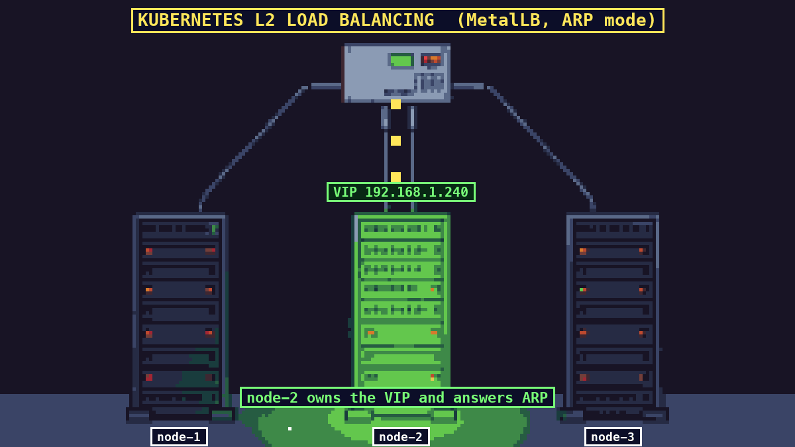

# How L2 load balancing works in bare-metal Kubernetes (and what v1.36 / v1.37 changed)



On bare metal there is no cloud load balancer, so many clusters use MetalLB in L2 mode. It is simple, but it is often misunderstood:

- A Service of type LoadBalancer gets a virtual IP (VIP) from a pool.
- Only ONE node "owns" that VIP at a time. It answers ARP requests: "192.168.1.240 is at my MAC".
- All external traffic for the VIP lands on that single node. From there kube-proxy spreads it across Pods on any node.
- If the node dies, another node is elected and sends a gratuitous ARP. Switches update their tables and the VIP moves. Failover usually takes a few seconds.

So L2 mode gives you high availability, not true load balancing between nodes. The ingress bandwidth of one node is your ceiling. If you need traffic spread across nodes, look at BGP mode or an external L4 balancer.

## What changed upstream

- **Kubernetes v1.37** deprecated kube-proxy's IPVS mode. It now logs a warning, is expected to be disabled by default in v1.40 and removed in v1.43. If you run IPVS behind MetalLB, plan the move to nftables mode now.
- **Kubernetes v1.36** deprecated Service `.spec.externalIPs` (CVE-2020-8554). If you used externalIPs as a "poor man's load balancer" on bare metal, move to `type: LoadBalancer` with MetalLB or another LB implementation.

Check your kube-proxy mode:

```sh
kubectl -n kube-system get configmap kube-proxy -o jsonpath='{.data.config\.conf}' | grep 'mode:'
```

Sources: [Kubernetes v1.37 release](https://kubernetes.io/blog/2026/08/26/kubernetes-v1-37-release/), [v1.36: deprecation of Service ExternalIPs](https://kubernetes.io/blog/2026/05/14/kubernetes-v1-36-deprecation-and-removal-of-service-externalips/).

## Files

- `l2_failover.gif`, `l2_failover.mp4`: the animation (1200×675, 12 fps).
- `background.png`: 240×135 pixel-art background.
- `animate.py`: draws the packets, failover and labels over the background and renders the GIF and MP4 (Pillow + ffmpeg). Run it from this folder.
