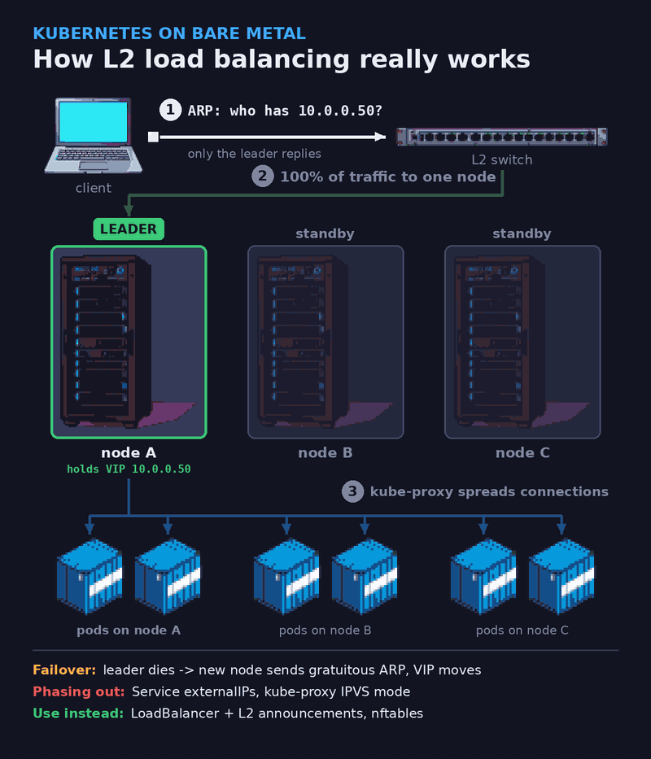

# How L2 load balancing really works on bare-metal Kubernetes

*2026-11-17*



Full quality: [video (MP4)](l2-failover.mp4) · [static diagram (PNG)](l2-diagram.png)

On bare metal there is no cloud load balancer. For years the shortcuts were Service `externalIPs` and kube-proxy in IPVS mode. Both are on the way out:

- Service `.spec.externalIPs` is deprecated since v1.36 (CVE-2020-8554). Plan: disabled by default in v1.40, removed in v1.43.
- kube-proxy IPVS mode is deprecated. Same plan: off by default in v1.40, removed in v1.43. nftables is the way forward.

The latest release, v1.37, keeps both on that path. So the clean setup is a Service of type `LoadBalancer` plus L2 announcements (MetalLB or Cilium).

## How L2 mode works

1. The Service gets a virtual IP from a pool, for example `10.0.0.50`.
2. One node is elected leader for that IP. When a client asks "who has 10.0.0.50?", only the leader answers ARP with its MAC.
3. The switch sends all traffic for that IP to this one node.
4. From there kube-proxy spreads connections across pods on every node.
5. If the leader dies, another node takes over and announces the IP with a gratuitous ARP. Failover takes seconds.
6. Pods that ran on the dead node are gone until Kubernetes recreates them on healthy nodes (about 5 minutes with default tolerations).

## What people get wrong

L2 mode is high availability, not load balancing between nodes. One node's bandwidth is your ceiling. If you need traffic spread across nodes, use BGP mode or an external L4 balancer.

Check which mode your kube-proxy runs:

```bash
kubectl -n kube-system get cm kube-proxy -o jsonpath='{.data.config\.conf}' | grep mode
```

What do you run on bare metal: L2 or BGP?
